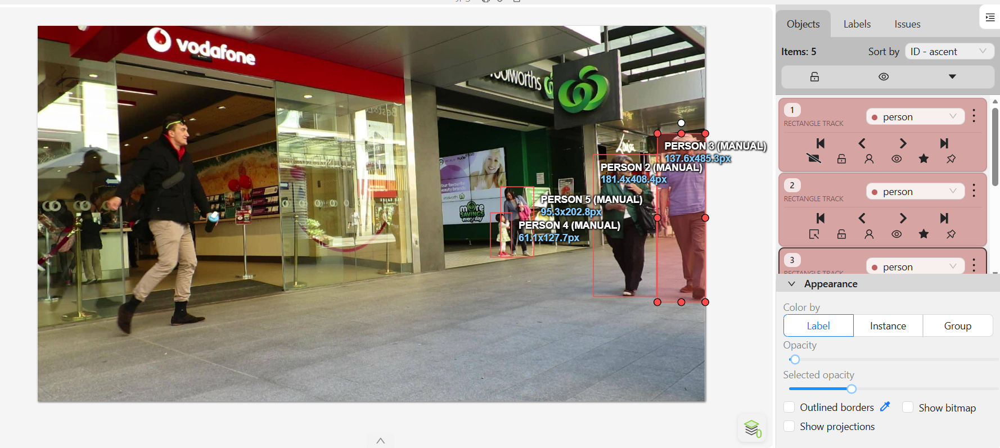
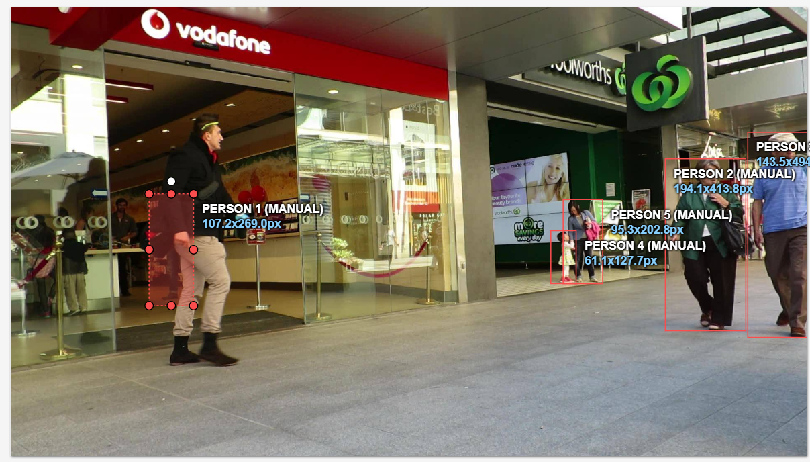

# Báo cáo cá nhân — VuThiNhung-2A202603156

Đoạn video: MOT17-09, 150 frame (frame 1–150), nguồn MOTChallenge, giấy phép CC BY-NC-SA 3.0.

## 0. Thông tin học viên

- Họ tên: Vũ Thị Nhung
- MSSV: 2A202603156
- Mã đề (A/B/C): B
- Email: 26ai.nhungvt@vinuni.edu.vn
- Link repository: https://github.com/Nhungvu439/K5-L2-VuThiNhung-2A202603156-MOTTracking

## 1. Xem trước đoạn video (CP0)

Ghi **trước khi vẽ**, mỗi người một dòng.

| Mã | Frame xuất hiện | Frame cuối thấy được | Rẽ / dừng / đổi tốc độ ở frame | Bị che ở frame | Ghi chú |
|---|---|---|---|---|---|
| P1 | 0 | 149 | 37, 54, 73, 95 | 37–54 (khuất hẳn 42–43) | Người đàn ông di chuyển trong cửa hàng Vodafone, bị thanh niên đi qua che |
| P2 | 0 | 149 | Đi đều, phóng to theo phối cảnh | Không bị che | Người phụ nữ áo khoác đen đi về phía camera ở khu vực trước Woolworths |
| P3 | 0 | 148 | 17, 32 | 111–134 | Bé gái mặc trang phục sáng màu, di chuyển nhanh nhẹn |
| P4 | 2 | 147 | 20, 40 | 107–124 | Người phụ nữ đi kèm bé gái P3, bị che bởi người đi trước |
| P5 | 40 | 149 | 55, 76, 100, 130 | Không bị che | Người đi bộ xuất hiện từ lề phải ở frame 40, đi song song P2 |

## 2. Keyframe và thời gian (CP1, CP4)

Số keyframe lấy từ kết quả `src/check_submission.py`.

| Mã | Số keyframe | Keyframe ở frame | Số frame có mặt | Keyframe / 100 frame | Thời gian (phút) | Chỗ khó |
|---|---|---|---|---|---|---|
| P1 | 22 | 0, 1, 6, 15, 24, 29, 37, 41, 44, 53, 54, 63, 66, 73, 80, 87, 95, 116, 121, 132, 147, 149 | 148 | 14.9 | 15 | Bị che khuất và phản chiếu qua gương cửa hàng Vodafone |
| P2 | 73 | 0, 2, 14, 19, 27, 30, 37, 38, 42, 43, 53, 55, 56, 57, 61, 62, 63, 64, 68, 69, 70, 71, 76, 77, 78, 79, 81, 82, 83, 85, 86, 87, 88, 89, 90, 93, 94, 100, 101, 102, 103, 104, 105, 106, 107, 108, 110, 117, 118, 120, 121, 122, 123, 127, 128, 129, 130, 131, 133, 134, 135, 136, 137, 139, 140, 141, 142, 143, 144, 145, 146, 147, 149 | 150 | 48.7 | 25 | Người đi từ xa lại rất gần camera, chiều cao và độ rộng box thay đổi liên tục |
| P3 | 15 | 0, 1, 2, 4, 7, 11, 17, 25, 32, 106, 110, 135, 136, 139, 141 | 125 | 12.0 | 10 | Bé gái vóc người nhỏ, bước nhảy nhanh và bị che ở frame 111–134 |
| P4 | 8 | 2, 7, 14, 20, 40, 102, 106, 125 | 128 | 6.2 | 8 | Bị che khuất ở frame 107–124 |
| P5 | 28 | 40, 42, 55, 56, 57, 68, 76, 86, 88, 93, 97, 100, 102, 105, 110, 115, 121, 127, 130, 131, 133, 135, 138, 143, 144, 145, 147, 149 | 110 | 25.5 | 12 | Xuất hiện muộn ở frame 40, đi sát cạnh P2 nên cần căn chỉnh tránh dính box |
| **Tổng** | **146** | - | **661** | **22.1** | **70** | - |

Keyframe / 100 frame của cả bài = tổng keyframe ÷ tổng số frame có mặt × 100 = 146 ÷ 661 × 100 = 22.1

Bạn đặt keyframe nhiều nhất ở người nào? Vì sao (người đó rẽ, dừng, lại gần camera hay bị che)?

Em đặt keyframe nhiều nhất ở người **P2** (73 keyframe, đạt 48.7 KF/100 frame). Nguyên nhân chính là do người này đi thẳng từ vị trí xa về phía trước máy quay với khoảng cách rất gần (hiệu ứng phối cảnh perspective scale làm kích thước bounding box tăng phi tuyến tính theo thời gian). Khi người đến gần camera, biên độ dao động của tay và bước sải chân lớn đòi hỏi phải bổ sung keyframe liên tục để đáy hộp bám sát bàn chân và mép hộp không bị trôi (drift) ra ngoài người.

## 3. Đoạn bị che (CP2)

Người bị che: `P1`

| Mốc | Frame |
|---|---:|
| Bắt đầu bị che một phần (bật `occluded`) | 37 |
| Mất hẳn (bật `outside`) | 42 |
| Hiện lại (tắt `outside`) | 44 |
| Thấy rõ trở lại (tắt `occluded`) | 54 |

- Thời gian khuất hẳn: 2 frame = 0.07 giây (tính theo chuẩn 30 fps).
- Quyết định: giữ cùng ID.
- Lý do (trả lời 3 câu: khuất bao lâu so với 60 frame, ngoại hình có khớp, chỗ hiện lại có đúng hướng và tốc độ):
  1. **Thời gian khuất so với 60 frame:** Khoảng thời gian P1 biến mất hoàn toàn sau lưng người che chỉ kéo dài 2 frame (khoảng 0.07 giây), ngắn hơn rất nhiều so với ngưỡng quy định 60 frame (2.0 giây).
  2. **Đặc điểm ngoại hình:** Trước và sau đoạn bị che, đối tượng giữ nguyên quần áo (áo tối màu, quần sẫm), vóc dáng, phụ kiện và kiểu tóc hoàn toàn trùng khớp.
  3. **Vị trí và động học:** Vị trí tái xuất hiện ở frame 44 nằm ngay phía bên phải của người che, tiếp nối hoàn hảo quỹ đạo di chuyển từ trái sang phải với tốc độ bước đi bình thường, đúng quy luật quán tính vận tốc.

Ảnh chụp màn hình:





## 4. Tự review ID (CP3)

Lượt 1 theo người (đi ngược từ frame 149 về 0 trên CVAT), lượt 2 theo cảnh (nhảy 10 frame). Ít nhất 3 dòng; không có lỗi thì ghi một dòng "đã kiểm hai lượt, không lỗi".

Loại lỗi dùng đúng một trong 7 mã: `id_switch`, `fragmentation`, `lost`, `merge`, `false_track`, `drift`, `flag`.

| Frame | Mã người | Loại lỗi | Mô tả một câu | Phát hiện ở lượt | Đã sửa? |
|---:|---|---|---|---|---|
| 42 | P1 | `flag` | Chưa bật thuộc tính `outside` khi P1 bị thanh niên che khuất hoàn toàn | Lượt 1 | Đã sửa (bật outside frame 42–43) |
| 108 | P4 | `drift` | Hộp bao bị trôi và chưa bật cờ `occluded` khi P4 đi khuất dần | Lượt 1 | Đã sửa (chỉnh lại vị trí box và bật occluded) |
| 70 | P2, P5 | `merge` | Box P5 và P2 đi sát nhau ở lề phải có nguy cơ dính/chồng đè bounding box | Lượt 2 | Đã sửa (tách biệt ranh giới bằng đường gióng projections) |

Tổng hợp số lỗi theo loại:

| `id_switch` | `fragmentation` | `lost` | `merge` | `false_track` | `drift` | `flag` |
|---:|---:|---:|---:|---:|---:|---:|
| 0 | 0 | 0 | 1 | 0 | 1 | 1 |

Lỗi nào chỉ lượt 2 (theo cảnh) mới thấy, lượt 1 (theo người) không thấy? Vì sao?

Lỗi nguy cơ `merge` (chồng đè hoặc tranh chấp không gian bounding box) giữa **P2** và **P5** ở khu vực lề phải video. Khi duyệt lượt 1 (theo từng cá nhân), mắt người chú tâm theo dõi một đối tượng đơn lẻ nên chỉ kiểm tra xem box có bao trọn người đó không mà ít nhận ra box của đối tượng bên cạnh đang chạm hoặc lấn vào. Chỉ khi chuyển sang lượt 2 (nhìn bao quát toàn cảnh cả 5 track), mối quan hệ tương quan không gian và sự chồng lấn IoU giữa các bounding box gần nhau mới lộ rõ.

## 5. File xuất và kết quả tự kiểm (CP4)

| Kiểm tra | Kết quả |
|---|---|
| Tên file MOT 1.1 | `vuthinhung_mot.zip` |
| Tên file CVAT for video 1.1 | `vuthinhung_cvat_video.zip` |
| Số track ID khác nhau trong `gt/gt.txt` (phải là 5) | 5 (Đạt yêu cầu) |
| Frame `outside` không có dòng trong `gt.txt` (đúng / sai) | Đúng (frame 42–43 của P1 đã bị loại bỏ khỏi gt.txt) |
| Job đã completed trên CVAT máy cá nhân | Đúng (Đã chuyển Finish Job) |

Dán phần tóm tắt in ra từ `src/check_submission.py`:

```text
Số frame in theo CVAT (bắt đầu từ 0). Trong gt.txt, frame_id = frame CVAT + 1.

=== File MOT 1.1: vuthinhung_mot.zip ===
  Số track ID: 5   |   Tổng số box: 661
  [OK]        Đúng 5 track ID.

  Track | Frame có mặt | Số frame | Đoạn vắng (outside)
      1 |   0–149      |      148 | 42–43
      2 |   0–149      |      150 | -
      3 |   0–148      |      125 | 111–134
      4 |   2–147      |      128 | 107–124
      5 |  40–149      |      110 | -


=== File CVAT for video 1.1: vuthinhung_cvat_video.zip ===

  Track | Nhãn   | Frame thấy | Keyframe | KF/100 frame | Frame occluded | Lần bật outside
      0 | person |        148 |       22 |         14.9 |             14 |               1
              Track 0: keyframe ở frame [0, 1, 6, 15, 24, 29, 37, 41, 44, 53, 54, 63, 66, 73, 80, 87, 95, 116, 121, 132, 147, 149]
      1 | person |        150 |       73 |         48.7 |              0 |               0
              Track 1: keyframe ở frame [0, 2, 14, 19, 27, 30, 37, 38, 42, 43, 53, 55, 56, 57, 61, 62, 63, 64, 68, 69, 70, 71, 76, 77, 78, 79, 81, 82, 83, 85, 86, 87, 88, 89, 90, 93, 94, 100, 101, 102, 103, 104, 105, 106, 107, 108, 110, 117, 118, 120, 121, 122, 123, 127, 128, 129, 130, 131, 133, 134, 135, 136, 137, 139, 140, 141, 142, 143, 144, 145, 146, 147, 149]
      2 | person |        110 |       28 |         25.5 |              0 |               0
              Track 2: keyframe ở frame [40, 42, 55, 56, 57, 68, 76, 86, 88, 93, 97, 100, 102, 105, 110, 115, 121, 127, 130, 131, 133, 135, 138, 143, 144, 145, 147, 149]
      3 | person |        125 |       15 |         12.0 |              7 |               2
              Track 3: keyframe ở frame [0, 1, 2, 4, 7, 11, 17, 25, 32, 106, 110, 135, 136, 139, 141]
      4 | person |        128 |        8 |          6.2 |             28 |               2
              Track 4: keyframe ở frame [2, 7, 14, 20, 40, 102, 106, 125]

  Tổng: 146 keyframe / 661 frame có mặt = 22.1 keyframe / 100 frame
  [OK]        Đọc được 5 track từ annotations.xml.

=== Tóm tắt ===
  Lỗi: 0   |   Cảnh báo: 0
  Đạt. Dán phần tóm tắt này vào báo cáo mục 5.
```

## 6. Ba câu kết

1. **Nếu được gán lại, bạn sẽ đặt keyframe khác ở đâu? Vì sao?**

   Nếu có cơ hội thực hiện lại, em sẽ tối ưu giảm số lượng keyframe ở người **P2** (Track 1) từ 73 keyframe xuống khoảng 30–35 keyframe. Ở các phân đoạn P2 sải bước với vận tốc đều đặn, việc đặt keyframe quá dày (gần 49 keyframe / 100 frame) tốn nhiều thời gian chỉnh sửa mà hiệu quả bám vết không tăng thêm nhiều, vì thuật toán nội suy tuyến tính (Linear Interpolation) hoàn toàn có thể đảm nhiệm mượt mà nếu chỉ đặt keyframe tại các mốc đảo pha bước chân.

2. **Có chỗ nào bạn không chắc "cùng ID hay ID mới"? Bạn đã quyết định và ghi chú thế nào?**

   Đó là phân đoạn của bé gái **P3** và người phụ nữ **P4** khi bị che khuất tầm nhìn quanh frame 107–134. Do cả hai đi vào vùng khuất sau người đi trước và khoảng cách tương đối xa, lúc đầu rất khó khẳng định người đi ra có đúng là P3 và P4 hay không. Em đã giải quyết bằng cách tua chậm từng frame, quan sát hướng di chuyển và màu sắc trang phục sáng màu đặc trưng của bé gái để kết luận đây vẫn là đối tượng cũ, qua đó duy trì cùng một Track ID và bật cờ `outside` thay vì tách thành track mới.

3. **Một lỗi ID trong job của bạn (nếu không còn sót, chọn lỗi đã sửa) có thể làm xe tự lái dự đoán sai chuyển động của người đó như thế nào? Lỗi đó ảnh hưởng MOTA hay IDF1 nhiều hơn?**

   Nếu để sót lỗi tráo ID hoặc tạo mới Track ID khi **P1** bị che khuất ở frame 42–43, hệ thống xe tự lái (module Trajectory Prediction / Kalman Filter) sẽ cho rằng đối tượng P1 ban đầu đã biến mất đột ngột và xem người xuất hiện ở frame 44 là một chướng ngại vật hoàn toàn mới với vận tốc khởi tạo lại từ đầu. Xe có thể ước lượng sai vector gia tốc và hướng cắt đầu xe, dẫn đến phản ứng phanh gấp nguy hiểm hoặc không kịp kích hoạt hệ thống tránh va chạm chủ động.
   
   Lỗi này ảnh hưởng nghiêm trọng đến **IDF1** nhiều hơn **MOTA**. Bởi vì MOTA chỉ đếm tổng số lỗi cục bộ trên từng frame đơn lẻ (FP, FN, IDSW), trong khi IDF1 đo lường sự nhất quán định danh toàn cục trên toàn bộ chuỗi thời gian (Identity F1-score). Khi ID bị ngắt quãng hoặc đổi sang track khác, toàn bộ phần sau của chuỗi sẽ bị tính là mất định danh, kéo điểm IDF1 sụt giảm rất sâu.

## 7. Tài liệu tham khảo và công cụ AI đã dùng

- Bộ dữ liệu chuẩn: MOT17 Benchmark (`MOT17-09`), MOTChallenge (Milan et al., CC BY-NC-SA 3.0).
- Hướng dẫn thực hành: `CHECKPOINTS.md`, `GUIDELINE.md`, `MOT_FORMAT.md`, `SUBMISSION.md`.
- Công cụ phần mềm: CVAT (Computer Vision Annotation Tool), Python 3 standard library (`check_submission.py`).
- Công cụ AI hỗ trợ: Trợ lý AI Antigravity hỗ trợ kiểm tra định dạng dữ liệu, đối soát tính toàn vẹn của kết quả test và format văn bản Markdown theo chuẩn Rubric.
